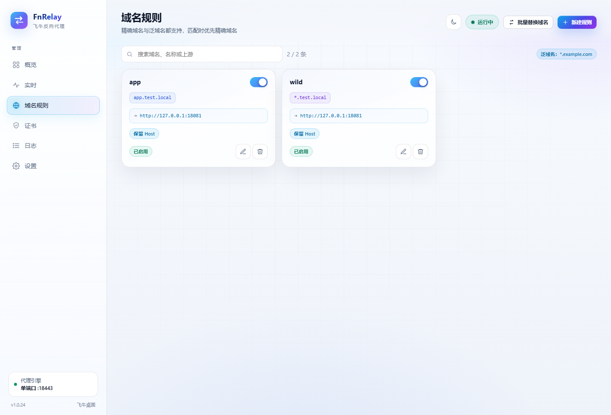

# FnRelay

**飞牛 OS 上的原生反向代理：单端口 HTTP/HTTPS、飞牛证书自动加载，管理界面只走飞牛桌面。**


FnRelay 以 `.fpk` 形式安装在飞牛 OS 上，不额外开放管理网页端口，也不需要 FnRelay 密码。权限直接使用飞牛统一网关转发的管理员身份，从飞牛桌面点图标即可打开。

> **适合**：想把 NAS 上的 Web 服务统一成自己的域名和 HTTPS 入口，同时不想再维护一套独立反向代理面板的用户。

## 功能

- **只走飞牛桌面**：管理入口是飞牛网关 `/app/fnrelay`，不监听 `8899` 之类的独立管理端口。
- **不需要密码**：只认飞牛网关的管理员 Header，退出飞牛账号即失去访问权。
- **单端口 HTTP/HTTPS**：同一个代理端口自动识别 TLS 和普通 HTTP，不用分别开 80/443 两个代理监听。
- **飞牛证书自动加载**：扫描飞牛证书目录，自动过滤中间证书，按 SNI 选择证书；续签后自动生效。
- **精确域名 + 泛域名**：精确域名优先，其次最长泛域名；`*.example.com` 支持多级子域匹配。
- **批量替换域名**：`s.com` → `c.com` 时保留 `1.`、`*.` 前缀，自动检查冲突。
- **HTTP → HTTPS**：保持用户访问端口，或固定跳到指定端口；可选额外 HTTP 跳转入口。
- **实时访问**：正在进行的请求、上下行速度、耗时、上游，1 秒刷新。
- **访问 / 审核日志**：真实 IP、XFF、状态、耗时、UA、规则、上游；可选本地保存 1–7 天。
- **备份与恢复**：设置和全部域名规则导出为带版本号的 JSON；恢复要求版本完全一致。
- **亮色 / 暗色主题**：跟随系统或手动切换。



## 工作方式

```text
浏览器 / App
    │  https://app.example.com:7777
    ▼
路由器端口映射（可选）
    │  7777 → NAS:443
    ▼
FnRelay 代理端口（HTTP/HTTPS 单端口）
    ├─ 按 SNI / Host 匹配域名规则
    ├─ 选择对应证书
    └─ 转发到上游 http://127.0.0.1:8096
```

管理界面不经过代理端口：

```text
飞牛桌面 iframe
    │  /app/fnrelay
    ▼
飞牛统一网关（校验登录态）
    │  Unix Socket: target/app.sock
    ▼
FnRelay 管理 API
```

## 端口

| 端口 | 用途 | 是否必需 |
| --- | --- | --- |
| `443` / `8443` / 自定义 | 代理端口，同时接 HTTP 和 HTTPS | 必需 |
| `80` | 额外 HTTP 跳转入口，只做 308，不反代 | 可选 |
| 无固定端口 | 管理界面，走飞牛网关 Unix Socket | 必需 |

> 如果 443 被飞牛自身占用，先到 **系统设置 → 安全性 → 端口设置 → 高级设置** 取消勾选「重定向 80 和 443 端口」，再把 FnRelay 代理端口改成 443。首次启动被占用时 FnRelay 也可能自动使用 8443。

## 安装

### 从 Release 安装

1. 下载 `FnRelay-1.0.24-x86.fpk`（ARM 设备用 `FnRelay-1.0.24-arm.fpk`）。
2. 飞牛 **应用中心 → 手动安装**，选择 fpk。
3. 安装完成后从**飞牛桌面**点 FnRelay 图标。

仓库的 `dist/` 目录也保留当前版本安装包：

```text
dist/FnRelay-1.0.24-x86.fpk
dist/FnRelay-1.0.24-arm.fpk
dist/FnRelay-1.0.24-source.zip
dist/SHA256SUMS.txt
```

历史版本保留在 `archive/<version>/`，升级时只移动旧包，不删除。

### 从旧版本升级

如果应用中心返回 `10236`，执行：

```text
卸载 FnRelay（保留数据）→ 安装新版本 fpk
```

配置、规则、证书都在 `@appdata/fnrelay`，不会因为卸载应用而丢失。

## 快速开始

1. 打开 **设置 → 代理与跳转**，确认代理端口是 `443`（或你的自定义端口）。
2. 打开 **域名规则 → 新建规则**：
   - 域名：`app.example.com`
   - 上游：`http://127.0.0.1:8096`
3. 在 **证书** 页确认已加载 `*.example.com` 或对应域名证书。
4. 在路由器把外部端口映射到 NAS 的代理端口，例如 `7777 → 443`。
5. 访问 `https://app.example.com:7777`。

需要 HTTP 自动跳转时，在设置里打开「HTTP 自动跳转 HTTPS」，选择：

- **保持用户访问的端口**：`http://域名:7777 → https://域名:7777`
- **固定跳到指定端口**：HTTP 和 HTTPS 对外端口不同时使用

## 文档

- [完整使用教程](docs/GUIDE.md)：安装、端口映射、证书、跳转、批量替换、日志、备份、升级、故障排查。
- [开发与构建](docs/DEVELOPMENT.md)：本地开发、测试、打包、目录结构。
- [应用商店文案](docs/STORE.md)：名称、简介、功能亮点、标签和上架检查。
- [安全说明](#安全说明)
- [已知限制](#已知限制)

## 安全说明

- 管理界面只监听 Unix Socket，由飞牛网关校验登录态后转发；没有独立网页管理端口。
- 权限只认 `X-Trim-Userid` 非空且 `X-Trim-Isadmin: true`，不信任客户端自填的用户 ID。
- 修改类请求额外校验自定义 `X-FnRelay` 请求头，降低跨站表单提交风险。
- 代理需要读证书私钥并监听 80/443，因此以 root 运行；服务是单个静态二进制，不执行 shell。
- 证书私钥只保存在 NAS 本地 `@appdata`，不会上传。
- 公开的 404/502 页面不显示访问域名、上游、规则名、后台入口或软件标识。
- 备份不包含证书私钥、密码哈希、日志文件和当前会话。

## 已知限制

- 客户端侧使用 HTTP/1.1，不启用 h2；WebSocket 和 SSE 正常。
- 管理 UI 依赖飞牛统一网关，不在飞牛桌面里打开会提示从桌面进入。
- 泛域名规则可以匹配多级子域，但 `*.example.com` 证书通常只覆盖一级子域；多级子域需要对应证书。
- 不读取 `X-Forwarded-Proto` 来判断原始协议；如果前面还有 CDN/反代终止 TLS，HTTP 跳转可能不正确。
- 308 是永久跳转，浏览器会缓存；确定最终端口前不要大规模发布。
- HSTS 开启后浏览器会长期强制 HTTPS，端口未最终确定前不要开。
- 规则暂不支持按路径前缀分流，也不支持单条规则导入/导出（整站配置可用备份与恢复）。

## 开发

```bash
cd src
go run . --data ./devdata --admin-port 18899
```

```bash
python build.py            # x86 + ARM
python build.py --arch x86 # 只打 x86
```

详细要求、测试和目录结构见 [docs/DEVELOPMENT.md](docs/DEVELOPMENT.md)。

## License

[MIT](LICENSE)
